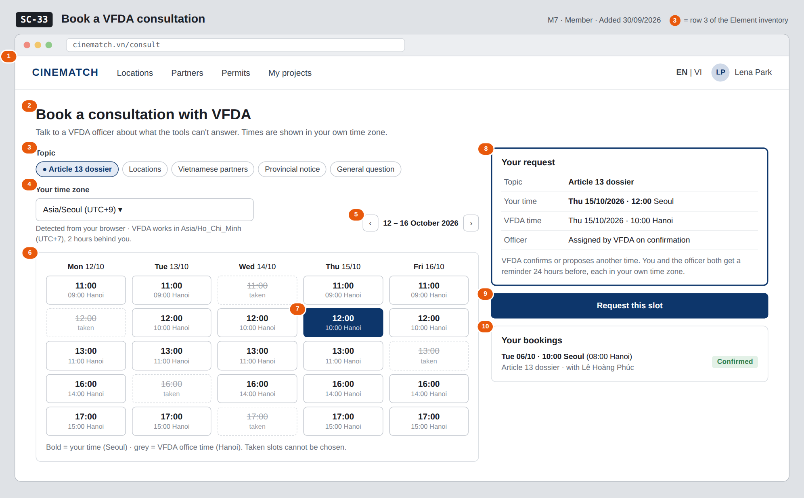

# Screen Spec: SC-33 Book a VFDA consultation

> DBIZ3 Session 4 template — one file per screen. The Screen ID is kept from the DBIZ2 Screen List.
> The mockup image stays an image; everything around it is text.
> **Each orange numbered badge on the mockup is the row with the same number in section 3 (Element inventory).**

| Field | Value |
|---|---|
| Screen ID | `SC-33` |
| Screen name | Book a VFDA consultation |
| Actor | Member |
| Priority | Should |
| Belongs to module | `docs/spec/spec-M7.md` |
| Mockup image | `img/SC-33.png` |
| Status | Draft |

*Route:* `/consult` · *Screen list file:* M7, item #36 (Added 30/09/2026 — Should) · *Design note from the screen list file:* Consultation request, not a slot calendar (M7 BR-005, Clarifications Q5; rewritten 06/11/2026). The mockup image still shows the slot grid of the first design: rows 5–7 now describe the preferred-time fields that replace it, until the image is redrawn.

**Notes against Screen List v2.0**

- New Screen Spec written on 30/09/2026; SC-33 had no spec or mockup in the first set of 20. Rewritten on 06/11/2026 for M7 BR-005.

## 1. Purpose

**Shown when:** A signed-in member clicks *Contact VFDA* in the footer, *Contact VFDA for an invitation* on `SC-04`, *Book a consultation* on `SC-12`, or an *Ask VFDA* link on a project screen; guests are sent to `SC-04` first.

**The user leaves this screen when:** The member sends the request and stays on the page with it listed under *Your requests*, or leaves through the navigation bar.

## 2. Mockup

> The image is the visual contract (layout, grouping, hierarchy); the tables below are the behavioural contract.
> All data in the mockup is sample data for one fictional project (*The Last Ferry*, Harbour Line Films); organisation names, people and phone numbers are examples, not real records.

## 3. Element inventory

| # | Element | Type | Content / data source | Required | Validation |
|---|---|---|---|---|---|
| 1 | Navigation bar | Header | static | — | — |
| 2 | Title + purpose | Header + Text | static: VFDA replies by email with a proposed time | — | — |
| 3 | Topic | Toggle (single-select chips) | `topic` — ENUM(dossier, locations, partners, provincial_notice, general) | Yes | exactly one value of the enum |
| 4 | Time zone | Toggle (dropdown) | `timezone` — IANA name, VARCHAR(40); default from the browser | Yes | must be a valid IANA time zone |
| 5 | *+ Add another time* button | Button | static | — | hidden once three times are entered |
| 6 | Preferred times | Input (date and time), 1–3 | `preferred_times` — JSONB, 1–3 start times entered in `timezone`, stored in UTC; `slot_start` = the first | Yes | at least one; each in the future and at most 180 days ahead; no duplicates |
| 7 | Hanoi time under each preferred time | Text | the same time in Asia/Ho_Chi_Minh | — | — |
| 8 | *Your request* summary | Text | topic and every preferred time in `timezone` and in Asia/Ho_Chi_Minh | — | — |
| 9 | *Send request* button | Button | stores the request (`booking_id`) and emails it to VFDA | — | disabled until 3, 4 and one valid time in 6 are set |
| 10 | *Your requests* list | List | the member's requests: topic, preferred times in `timezone`, status — *Waiting for VFDA* while `booking_status` is empty | — | upcoming first (by the first preferred time) |

## 4. States

| State | What the user sees | Trigger |
|---|---|---|
| Default | Topic chips, time zone, one preferred-time field with *+ Add another time*, the summary and *Your requests*. | Page opens |
| Empty (no data) | No request yet: *Your requests* shows *None yet*. | 0 requests |
| Loading | *Send request* shows *Sending…* and is disabled. | Sending |
| Error | Field messages: no topic, unknown time zone, a time in the past or more than 180 days ahead, the same time twice. Write failure: *Couldn't send — nothing was saved, try again*. | Validation / write error |
| Success / confirmation | Banner *Request sent — VFDA will reply by email with a proposed time*; the request appears under *Your requests* as *Waiting for VFDA*. If the email to VFDA could not be sent: *Request saved — VFDA will see it; the email could not be sent*. | Request stored |

## 5. Interactions and navigation

| # | Element | User action | System response | Goes to screen |
|---|---|---|---|---|
| 1 | Topic chip | tap | Selects the topic | stays |
| 2 | Time zone dropdown | tap | Changes the zone; the preferred times and the summary re-render in the new zone | stays |
| 3 | *+ Add another time* | tap | Adds a preferred-time field (at most three) | stays |
| 4 | *Send request* | tap | Stores the request, then emails it to VFDA with every time in the member's zone and Hanoi time | stays |
| 5 | *Log in* (guest redirect) | tap | — | SC-04 |

## 6. Screen-level rules

| Rule ID | Rule | Source |
|---|---|---|
| SR-361 | Preferred times are stored in UTC with the member's IANA `timezone`; every time on screen and in the email is shown in the member's zone with Hanoi time alongside. | M7 FR-005 |
| SR-362 | This is a request, not a booking: VFDA staff reply by email with a proposed time; no slot calendar, officer or reminder in the MVP. | M7 BR-005; Clarifications Q5 |
| SR-363 | The topic is one of five fixed values so VFDA can route and count requests. | M7 §5.1 FR-005 |
| SR-364 | Only signed-in members can send a request; a deactivated account has no access. | SYS BR-005 |

## 7. Linked requirements

| FR ID (from the module spec) | What this screen does for it |
|---|---|
| FR-005 · spec-M7.md (F-M7-05) | Send a consultation request: topic, 1–3 preferred times, time zone |

## 8. Responsive and accessibility notes

- Minimum supported width: **360px**.
- Narrow screens: the preferred-time fields stack; the summary and *Send request* stick to the bottom.
- Each preferred-time field has a label that names its number and the time zone (e.g. *Preferred time 2, Asia/Seoul*); the Hanoi time is read with it.
- Status in *Your requests* is text, not colour alone.

## 9. Open questions

| # | Question | Blocking? | Status |
|---|---|---|---|
| 1 | [NEEDS CLARIFICATION: Which days and hours does VFDA offer for consultations, and how long is one slot?] | Yes | Open |
| 2 | [NEEDS CLARIFICATION: How is the consultation held (video call, phone, at the VFDA office) and who sends the joining details?] | No | Open |

## Completion checklist

- [x] The mockup is a separate cropped image file, named with the Screen ID (`img/SC-33.png`).
- [x] Every visible element in the mockup appears in the element inventory — machine-checked: badge numbers on the image = row numbers in section 3.
- [x] Every input element has a validation rule or an explicit "—".
- [x] All five states are filled in, or marked "Not applicable" with a reason.
- [x] Every navigation target is a Screen ID that exists in `docs/screen-list.md` — machine-checked.
- [x] Every element that displays data names the field it displays, matching `docs/spec/spec-M7.md` section 5.1.
- [ ] **Checked by a person:** _(not signed — a Group C member compares the image with the tables and signs here)_

---
*DBIZ3 Session 4 · Group C · CINEMATCH. Built on the DBIZ2 Screen Design (Screen List and Screen Layout).*
