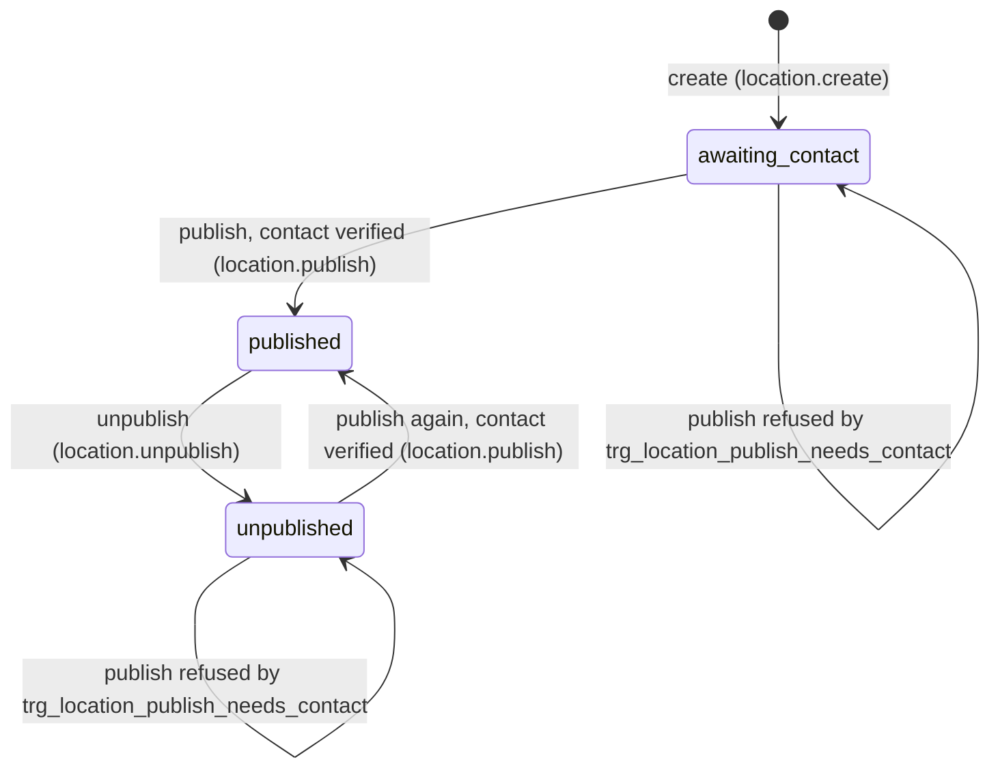

# Data Model: Location publishing by VFDA (M3 US-3, SC-35)

Feature: `002-m3-publish` · Source of every column and check: `data/schema/schema-M3.sql`, `data/schema/schema-M10.sql`, `data/data-model-M3.md`. This feature adds **no column and no table**; it adds two local triggers (see [research.md](research.md) R1) and the rules below.

## 1. Entities

### Location (`location`) — FR-001, FR-002, FR-005

The 20 fields of the data-entry template (FR-002, spec §5.1):

| # | Field | Type | Required | Rule (schema / SC-35) |
|---|---|---|---|---|
| 1 | `name_vi` | VARCHAR(200) | Yes | ≤ 200 characters |
| 2 | `name_en` | VARCHAR(200) | Yes | ≤ 200 characters; source of the slug of a new location (research R6) |
| 3 | `province_id` | INTEGER | Yes | one of the 34 rows of `province` (BR-006) |
| 4 | `district` | VARCHAR(120) | No | ≤ 120 characters |
| 5 | `lat` | NUMERIC(9,6) | Yes | 8–24 (`ck_location_in_vietnam`) |
| 6 | `lng` | NUMERIC(9,6) | Yes | 102–110 (`ck_location_in_vietnam`) |
| 7 | `airport_km` | INTEGER | No | integer |
| 8 | `scene_types` | 14-value enum list | Yes | at least one; karst, river, village, rice_field, sea, floating_village, cave, jungle, old_town, market, rice_terrace, mountain, dunes, mangrove |
| 9 | `desc_vi` | TEXT | Yes | not empty |
| 10 | `desc_en` | TEXT | Yes | not empty |
| 11 | `crew_capacity` | enum | Yes | u15 / 15_50 / o50 |
| 12 | `lodging_20km` | BOOLEAN | Yes | true / false |
| 13 | `grid_power` | BOOLEAN | Yes | true / false |
| 14 | `truck_access` | BOOLEAN | Yes | true / false |
| 15 | `months_to_avoid` | INTEGER list | No | each 1–12; `[]` = none recorded, missing = no data yet |
| 16 | `permit_complexity` | enum | Yes | low / medium / high |
| 17 | `restriction_note` | TEXT | No | — |
| 18 | `availability` | enum | Yes | open / survey_in_progress / paused (BR-010) |
| 19 | `night_shooting_allowed` | enum | No | yes / no / ask (Clarifications Q3) |
| 20 | `rainy_months` | INTEGER list | No | each 1–12; `[]` = none recorded, missing = no data yet (Clarifications Q3) |

System-set columns: `location_id` (UUID, new on create), `slug` (VARCHAR(160), unique, set once on create), `intake_status` (awaiting_contact / published / unpublished), `published` (must equal `intake_status = published`, `ck_location_published_matches_status`), `blocked_reason` (TEXT: why publishing is blocked, or why the location was unpublished, as in the seed).

### AuthorityContact (`authority_contact`) — FR-004, BR-004

| Field | Type | Required | Rule |
|---|---|---|---|
| `location_id` | UUID | Yes | primary key; one contact per location |
| `authority_name` | VARCHAR(200) | Yes | ≤ 200 |
| `contact_name` | VARCHAR(120) | Yes | ≤ 120 |
| `contact_phone` | VARCHAR(20) | Yes | ≤ 20 |
| `contact_email` | VARCHAR(254) | No | ≤ 254, e-mail format |
| `contact_verified` | BOOLEAN | — | false after every save that changes the contact (SR-314); true only through *Mark contact as verified* |
| `verified_by` | UUID → `user_account` | Yes (NOT NULL) | the staff member who last saved or verified the contact; seed `mui-ne` shows an unverified contact with `verified_by` set and `verified_at` empty (research Open question 9) |
| `verified_at` | TIMESTAMPTZ | — | server time of the verification; empty after every save |

Display of *verified by*: `profile.full_name` of `verified_by` (seed `03_profile.csv`), e.g. *✓ verified by Nguyễn Thị Thu Hà, 30/09/2026* (SC-35 Success state).

### AuditLog (`audit_log`, owner M10) — SR-317, BR-010, M10 FR-008 / BR-005

| Field | Type | Rule |
|---|---|---|
| `audit_log_id` | UUID | new per row |
| `action` | VARCHAR(60) | one of the actions in §3 |
| `admin_id` | UUID → `user_account` | the acting staff member (research R3) |
| `target_id` | UUID | the `location_id` |
| `logged_at` | TIMESTAMPTZ | server time |

Append-only: UPDATE and DELETE are refused by `trg_audit_log_append_only` (M10 BR-005).

### LocationImage (`location_image`) — FR-003, read-only in this feature (D3)

`image_url`, `location_id`, `image_source`, `usage_right`, `status` (pending / approved / hidden). SC-35 shows the count, the pending count and each photo with its source, usage right and status. No upload, no status change. Only `approved` photos are shown publicly (SC-35 SR-313), as SC-16 already does.

## 2. State transitions of a location

Rules:

- A new location always starts as `awaiting_contact`, `published = false` (SC-35 #4). Creating it as published is refused by the trigger (no contact can exist before the location).
- `published` is reached only through *publish*, and only when `authority_contact.contact_verified = true` at that moment (BR-004). The trigger refuses even a direct SQL update.
- *Unpublish* applies to a published location only; the row is kept (BR-008). There is no delete (SC-35 SR-312); `DELETE /api/admin/locations/:id` answers 405.
- Editing fields keeps the current status. Saving the contact of a published location keeps it published and makes the contact *not verified* (D4); the public side then hides the contact until it is verified again (research R8).
- Publish or unpublish requested from a status that does not allow it (for example unpublish an `awaiting_contact` location, or publish a location that is already published) is refused with 409 and changes nothing.
- `blocked_reason`: set to *Authority contact not verified (M3 BR-004).* when a publish is refused; cleared on a successful publish; set to the optional unpublish reason on unpublish (research Open question 3).

## 3. Audit actions (decision D2)

| Action | Written when | Rows |
|---|---|---|
| `location.create` | a location is created | 1 |
| `location.update` | location fields other than `availability` change, or the contact is saved | 1 |
| `location.availability` | `availability` changes (BR-010) | 1 (and 1 `location.update` too if other fields change in the same save) |
| `location.contact_verify` | *Mark contact as verified* succeeds | 1 |
| `location.publish` | publish succeeds | 1 |
| `location.unpublish` | unpublish succeeds | 1 |

No audit row is written when an action is refused or fails validation: the action and its row are committed together or not at all (M10 BR-005). A save that changes nothing writes no row.

## 4. Read models

- **Admin list row** (FR-001, SC-35 #7–11): `location_id`, `slug`, `name_vi`, `name_en`, `province` (name), `intake_status`, `availability`, `contact_verified`, `verified_at`, `photo_count`, `pending_photo_count`, `blocked_reason`.
- **Counts** (SC-35 #3): number of locations per `intake_status` and in total, for the whole catalogue (not only the filtered rows).
- **Admin detail** (SC-35 #12–23): the 20 fields, the system-set columns, the contact with `verified_by` name, the photos (read-only) and `can_publish` + `blocked_reason` for the *Publish* button.
