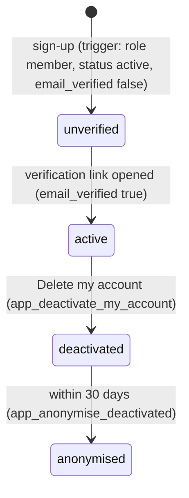

# Data Model: Platform foundation on Supabase (SYS)

Feature: `003-sys-core` · Sources: `data/schema/schema-*.sql` (46 tables, unchanged), `data/02-crud-matrix.md`, Actor column of `docs/function-list.md`, `data/data-model-*.md` §7 (named policies), [research.md](research.md) R2–R5, R13–R14.

This feature adds **no logical table or column**. It adds: the link to `auth.users` (§2), the role helpers and the policy matrix (§3), grants (§4), Postgres functions (§5) and two physical index additions (§6).

## 1. SYS entities (from `data/schema/schema-SYS.sql`)

| Table | Key | Columns used by this feature | Rules |
|---|---|---|---|
| `user_account` | `user_id` (= `auth.users.id`, no FK, D3) | `email` (unique), `email_verified`, `role` (6 values), `account_status` (`active` / `deactivated`), `created_at` | role `member` at sign-up (BR-002); changed only by `app_grant_role` with an audit row; never deleted (BR-005) |
| `producer_organisation` | `producer_org_id` | `org_name` ≤ 200, `country` CHAR(2), `website` ≤ 300 | created at sign-up (FR-001) |
| `profile` | `user_id` | `full_name` ≤ 120, `crew_role` (5 values), `locale` (`vi` / `en`), `producer_org_id` | empty org for staff, legal, admin, partner accounts (§6.1 of the spec) |
| `consent` | (`user_id`, `consent_version`) | `accepted_at` | stored with version and time (BR-003) |
| `notification` | `notification_id` | `recipient_id`, `event_type` ≤ 60, `payload` JSONB, `created_at`, `read_at` | one per event (SR-243); read only by its recipient (SR-241) |
| `email_delivery` | `email_delivery_id` | `notification_id`, `template_id`, `recipient_email`, `variables`, `delivery_status` (`queued` / `sent` / `bounced`), `provider_message_id` (unique) | queued first (D6) |

### Account states

`unverified` and `anonymised` are not stored statuses: the first is `email_verified = false`, the second is a deactivated account whose name and email were replaced. A deactivated account matches no policy (§3).

## 2. Link to Supabase Auth (research R5)

| Event on `auth.users` | Effect (one transaction) |
|---|---|
| INSERT (sign-up or *Add user*) | `user_account` row with the same id, the email, `email_verified = email_confirmed_at IS NOT NULL`, role **literal** `member`, status `active`. If `raw_user_meta_data` has `full_name`, `crew_role`, `org_name`, `country` and `consent_version`: also `producer_organisation`, `profile` (`locale` from metadata, default `en`) and `consent (accepted_at = now())`. |
| UPDATE of `email_confirmed_at` or `email` | `user_account.email_verified` and `email` follow. |

Nothing in the metadata can set a role, a status or an id.

## 3. Roles and policy matrix

**Helpers** (schema `app`, research R2): `app.current_role()` returns the role of an **active** account for `auth.uid()`, otherwise `guest`; `app.has_role(...)` treats `admin` as also `vfda_staff` and `vfda_legal` (D5). `app.is_project_member(project_id)` checks `project_member (project_id, user_id = auth.uid())`.

**Reading the matrix**: *anon* = no session. *signed-in* = any active role. Roles in brackets inherit (`vfda_staff` and `vfda_legal` include `admin`). **RPC** = written only through a Postgres function of §5. **System** = server with the secret key, no policy (D2). **Deferred (OQ n)** = the actor exists in the CRUD matrix but its rows cannot be scoped yet; no policy until the open question in [research.md](research.md) is answered (least privilege). No table has a DELETE grant or policy.

| Table | SELECT | INSERT | UPDATE | Source |
|---|---|---|---|---|
| `user_account` | own row; `admin` all | trigger (§2) | RPC `app_grant_role` (`admin`), `app_deactivate_my_account` (own) | F-SYS-01..04, BR-002, BR-005; policy `rls_user_account_role_grant` |
| `producer_organisation` | own (via `profile.producer_org_id`) | trigger (§2) | — | F-SYS-01; SC-08 shows it |
| `profile` | own | trigger (§2) | own: `full_name`, `crew_role`, `locale` (column grant); anonymisation RPC | F-SYS-01/04/05; SC-08 |
| `consent` | own | trigger (§2); new version: own row with current version | — | F-SYS-01, BR-003 |
| `notification` | own (`recipient_id = auth.uid()`) | System | own: `read_at` only (column grant) | F-SYS-07/09, SR-241 |
| `email_delivery` | — | System | System | F-SYS-08 |
| `segment_rule` | — | — | — | System (F-M1-02) |
| `segment_requirement` | signed-in | — | — | F-M1-02/03, F-M0-05 |
| `segment_decision` | — | `member` + project member | — | F-M1-02/03 (read by System) |
| `project` | project member | `member` | project member, not when `stage = 'archived'` | F-M0-01..03; policy `rls_project_archived_read_only` |
| `project_member` | members of the same project | `member` + project member (owner adds) | — | F-M0-01/04 |
| `project_province` | project member | `member` + project member | — | F-M0-01 |
| `readiness_snapshot` | project member | System | — | F-M0-08/09 |
| `rule_set_version` | — | System | — | F-M2-04 |
| `legal_rule` | anon + signed-in: approved and active only; `vfda_legal` all | `vfda_legal` | `vfda_legal` | F-M2-01..03; policy `rls_public_reads_approved_only` |
| `precheck_run` | — | System | System | F-M2-06/07 |
| `precheck_finding` | project member of the run's project | System | — | F-M2-13 |
| `compliance_run` | — | — | — | no function (CRUD anomaly) |
| `compliance_finding` | project member of the run's project | System | project member | F-M2-12..14 |
| `province` | anon + signed-in | — | — | reference list |
| `location` | anon + signed-in: published only; `vfda_staff` all | RPC (`vfda_staff`) | RPC (`vfda_staff`); embeddings System | F-M3-01..14, BR-004, BR-008 |
| `location_image` | anon + signed-in: `approved` of published locations; `vfda_staff` all | `vfda_staff` | `vfda_staff` | F-M3-03/13, SR-313 |
| `authority_contact` | signed-in: verified contacts of published locations; `vfda_staff` all | RPC (`vfda_staff`) | RPC (`vfda_staff`) | F-M3-04/05/15, BR-001, Clarifications Q1; policy `rls_authority_contact_members` |
| `location_query` | — | System | — | F-M3-11 (BR-009) |
| `project_shortlist` | project member | `member` + project member | — | F-M3-18 |
| `organisation` | anon + signed-in | Deferred (OQ 13) | `vfda_staff`; partner deferred (OQ 13) | F-M4-01/02/10 |
| `organisation_member_layer` | signed-in | Deferred (OQ 13) | `vfda_staff`; partner deferred (OQ 13); embeddings System | F-M4-01/03/06/07; policy `rls_org_member_layer_members` (Open question 14) |
| `organisation_private_layer` | `member` of a project whose request to the organisation is accepted with an NDA | Deferred (OQ 13) | Deferred (OQ 13) | F-M4-04; policy `rls_org_private_after_nda` |
| `verification_request` | `vfda_staff` | Deferred (OQ 13) | `vfda_staff` | F-M4-08..10 |
| `collab_request` | project member; partner deferred (OQ 13) | `member` + project member | partner deferred (OQ 13) | F-M4-12..14 |
| `collab_message` | — | Deferred (OQ 13) | — | F-M4-14 |
| `nda_acceptance` | project member of the request | Deferred (OQ 13) | — | F-M4-17 |
| `document_access_log` | project member of the document's project | System | — | F-M4-18/19 |
| `document_type` | signed-in | — | — | F-M5-01 |
| `document_slot` | project member | — | — | F-M2-08/09, F-M5-03 |
| `document` | project member (`rls_document_project_members`) | project member, as uploader | — | F-M5-02; `document.project_id` exists (research Open question 15, resolved) |
| `bilingual_document` | — | System | — | F-M5-04 |
| `bilingual_paragraph` | — | System | partner deferred (OQ 13) | F-M5-04..06 |
| `project_glossary` | — | System | — | F-M5-04 |
| `public_holiday` | signed-in | — | — | F-M5-08 |
| `location_interest` | project member | `member` + project member | — | F-M7-01/04 |
| `province_notice` | project member of the interest | System | Province deferred (OQ 1) | F-M7-02..04 |
| `consultation_booking` | `vfda_staff` | `member` as `member_id = auth.uid()` | `vfda_staff` | F-M7-05..07 |
| `moderation_item` | `vfda_staff` | Deferred (OQ 13) | `vfda_staff` | F-M10-01/02 |
| `audit_log` | `admin` | System and RPCs of §5 | — (append-only trigger) | F-M10-08/09, M10 BR-005 |
| `quarterly_report` | `vfda_staff` | System | `vfda_staff` | F-M10-06/07 |

Derived entities of the matrix (`READINESS_VIEW`, `DOSSIER_CHECK`, `LICENSING_TIMELINE`, `PROVINCE_READINESS`, `DEMAND_INDEX`) are not tables; they get their access when their views are built in their modules.

## 4. Grants (checked before RLS)

- `REVOKE ALL` on every application table from `anon` and `authenticated`, then grant only what §3 needs: `anon` → `SELECT` on `province`, `location`, `location_image`, `legal_rule`, `organisation`; `authenticated` → `SELECT` / `INSERT` / `UPDATE` on the tables and columns with a matching policy (column-level `UPDATE` for `notification.read_at` and `profile.full_name, crew_role, locale`).
- **No `DELETE`** for any role. `service_role` keeps its default rights (System).
- `EXECUTE` on the §5 functions for `authenticated` only; schema `app` is not exposed to the API.

## 5. Postgres functions (research R4, R12)

| Function | Who may call (checked inside) | Effect, one transaction |
|---|---|---|
| `app_admin_save_location(id, fields)` / create | `vfda_staff` | insert or update the 20 fields; audit `location.create` / `location.update` / `location.availability` |
| `app_admin_save_contact(location_id, contact)` | `vfda_staff` | upsert contact, verification cleared; audit `location.update` |
| `app_admin_verify_contact(location_id)` | `vfda_staff` | verified by `auth.uid()`, now; audit `location.contact_verify` |
| `app_admin_publish_location(id)` / `app_admin_unpublish_location(id, reason)` | `vfda_staff` | status change (BR-004 trigger applies); audit `location.publish` / `location.unpublish` |
| `app_grant_role(user_id, role)` | `admin` | role change; audit `role.grant` (BR-002) |
| `app_deactivate_my_account()` | the signed-in user | `account_status = deactivated`; audit `account.deactivate` |
| `app_anonymise_deactivated()` | System | name, email replaced for accounts deactivated since the last run (BR-005) |
| `app_search_locations(q)` | anon, signed-in | published locations matching the unaccented text index (FR-010) |
| `app_match_locations(embedding, k)` | anon, signed-in | published locations nearest to an embedding (FR-011) |

The local rules of `lib/db/local-triggers.sql` get their PostgreSQL versions in the same migration: `trg_location_publish_needs_contact` (BR-004) and `trg_audit_log_append_only` (M10 BR-005).

## 6. Physical additions (D9, research R13–R14)

| Object | Purpose |
|---|---|
| extension `unaccent`, function `app.f_unaccent(text)` (IMMUTABLE) | accent-insensitive text search (FR-010) |
| GIN index on `to_tsvector('simple', app.f_unaccent(name_vi ‖ name_en ‖ desc_vi ‖ desc_en))` of `location` | FR-010 |
| GIN index on the same over `capability_desc_vi ‖ capability_desc_en` of `organisation_member_layer` | FR-010 |
| extension `vector`; column `embedding VECTOR(768)` on `location` and `organisation_member_layer`; HNSW (cosine) indexes | FR-011 |

These live in `supabase/migrations/…000500_search_indexes.sql`, outside the schema-generated migration, as `tools/dm_model2.py` assigns them to the physical design.
