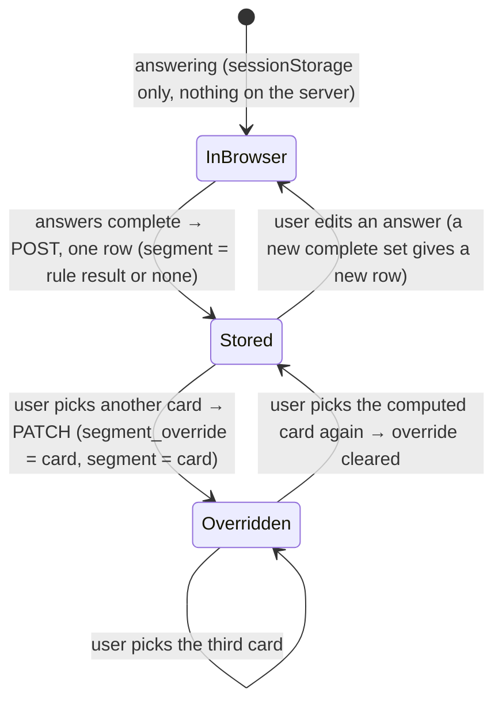

# Data Model: Segment router (M1)

Feature: `004-m1-router` · Sources: `data/schema/schema-M1.sql` (3 tables, unchanged), `data/data-model-M1.md`, [research.md](research.md) R1–R8.

This feature adds **no table or column**. It reads `segment_rule` and `segment_requirement`, writes `segment_decision`, and adds three rows to the seed through the generator (D1, research R4).

## 1. Tables used

| Table | Key | Columns used | Read / write in this feature |
|---|---|---|---|
| `segment_rule` | `segment_rule_id` | `q1_shoot_in_vn`, `q2_release`, `q3_producer`, `result_segment`, `version` | read, current version only (R1), by the server (System client) |
| `segment_requirement` | (`segment`, `requirement_code`) | `label_vi`, `label_en`, `needed` | read, all rows, by the server |
| `segment_decision` | `segment_decision_id` | `session_key`, `segment_rule_id`, `q1_shoot_in_vn`, `q2_release`, `q3_producer`, `q4_needs`, `segment`, `segment_override`, `decided_by`, `journey_config` (`project_id` stays empty) | insert one row per complete answer set; update `segment_override` and `segment` on override (R6) |

Constraints that already hold the rules: `ck_segment_rule_result_segment`, `ck_segment_decision_segment`, `ck_segment_decision_segment_override`, `ck_segment_decision_q2_release`, `ck_segment_decision_q3_producer`, `ck_segment_decision_one_owner` (project or session, never both).

## 2. Answers (FR-002 §5.1) — validation

| Field | Values | Required |
|---|---|---|
| `q1_shoot_in_vn` | `true` / `false` | yes |
| `q2_release` | `abroad`, `vietnam`, `both` | yes when q1 = true; must be empty when q1 = false |
| `q3_producer` | `foreign`, `vietnamese`, `coproduction` | yes when q1 = true; must be empty when q1 = false |
| `q4_needs` | subset of `locations`, `crew`, `cast`, `equipment`, `logistics`, no repeats | no (empty list allowed) |
| `segment_override` (PATCH only) | `A`, `B`, `C` | yes for an override |

An invalid set is refused with 422 and nothing is stored.

## 3. Decision (pure, `lib/router/decide.js`)

```text
current = rules with the highest version (numeric compare, R1)
match   = the rule of current where q1 equal and (rule.q2 empty or = q2) and (rule.q3 empty or = q3)
if q1 = false and q4 contains "locations"  → no match (spec §3 edge case, R3)
segment    = match.result_segment, or none
decided_by = [1] + [2 if match.q2] + [3 if match.q3], or []
q4 is never read to choose the segment (BR-002)
```

Result shown with the requirements of `segment` split into *Needed* / *Not needed* (US-1 Scenario 2), in the page language (`label_vi` / `label_en`).

`journey_config` (R7) = `{ needed, not_needed, needs: q4_needs, gauges }`, gauges = `content`, `locations`, `partners`, + `dossier` when `ART13_LICENCE` is needed.

## 4. A stored decision through its life



A row is never deleted. `project_id` is set later by M0 (US-3, not in this plan).

## 5. Seed rows added by the generator (D1, research R4)

| File | Row | Why |
|---|---|---|
| `07_segment_rule.csv` | `true, vietnam, coproduction → A, 2026.1` | Clarifications Q1 |
| `07_segment_rule.csv` | `true, both, coproduction → A, 2026.1` | Clarifications Q1 |
| `08_segment_requirement.csv` | `C, CREW_VISA, Thị thực cho đoàn phim, Visas for the crew, true` | Clarifications Q2 |

Keys stay UUIDv5 of readable names (deterministic); `check_seed.py` must PASS and `data/data-model-M1.md` counts are regenerated, not typed.
