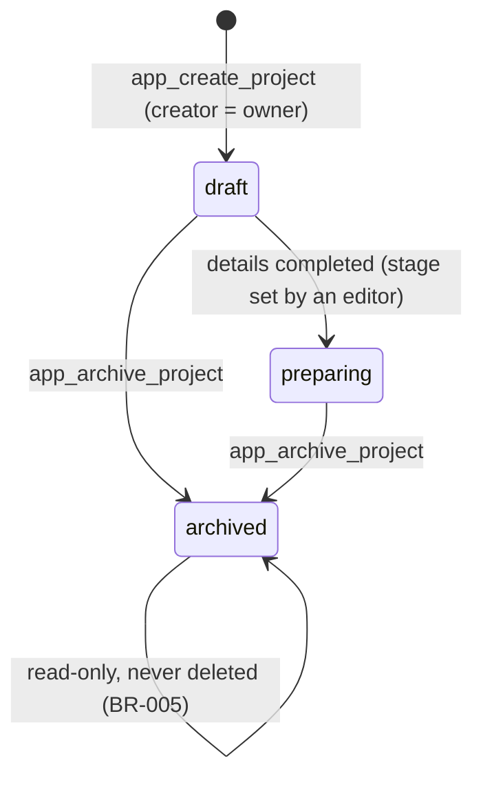

# Data Model: Project workspace and readiness dashboard (M0)

Feature: `005-m0-workspace` · Sources: `data/schema/schema-M0.sql`, `data/data-model-M0.md`, [research.md](research.md) R1–R10.

No new table or column. Changes to the data model, made in its generators (D1, D2): the value `owner` in `project_member.permission`; gauge rows in `segment_requirement`.

## 1. Tables used

| Table | Owner | Use |
|---|---|---|
| `project` | M0 | create (stage `draft`, `buffer_days` 7), update name / shoot date / logline, archive (`stage = archived`); never deleted (BR-005) |
| `project_member` | M0 | owner row at creation; pending invitations (`user_id` empty, `invitee_email`, `permission` view/edit); accepted rows |
| `project_province` | M0 | optional provinces at creation (34 ids of `province`) |
| `readiness_snapshot` | M0 | one row per active project per night (FR-008) |
| `segment_requirement` | M1 | `GAUGE_*` rows: gauges shown and counted per segment (D1) |
| `compliance_run`, `compliance_finding`, `rule_set_version` | M2 | Content gauge (read by the view) |
| `project_shortlist` | M3 | Locations gauge |
| `collab_request` | M4 | Partners gauge |
| `document_slot`, `document_type` | M5 | Dossier gauge (`A13_*` codes, their names for the next step) |
| `email_delivery` | SYS | queued invitation email (D3) |

## 2. Changes made through the generators

| Change | Source | Result |
|---|---|---|
| `PROJECT_MEMBER.permission` = `ENUM(owner, view, edit)` | `tools/dm_model2.py` | `ck_project_member_permission`; seed: the first member of each project becomes `owner`; migration `…m0_owner.sql` for pushed databases |
| `segment_requirement` gauge rows | `data/seed/generate_seed.py` (`REQ`) | A, B: `GAUGE_CONTENT`, `GAUGE_LOCATIONS`, `GAUGE_PARTNERS`, `GAUGE_DOSSIER` needed, `GAUGE_LOGISTICS` not needed; C: the same without `GAUGE_DOSSIER` (14 rows) |

## 3. View `v_project_readiness` (one row per project)

| Column | Type | Meaning |
|---|---|---|
| `project_id`, `segment` | | from `project` |
| `content_score`, `locations_score`, `partners_score` | NUMERIC(5,2) | R1 |
| `dossier_score` | NUMERIC(5,2) or NULL | NULL when the segment has no `GAUGE_DOSSIER` row (not shown, BR-002) |
| `logistics_score` | NULL | shown as `—` (BR-002) |
| `gauges_shown` | text | the segment's gauge names in display order (rows that exist) |
| `gauges_counted` | integer | number of `GAUGE_*` rows with `needed = true` (weights = 1 / this, BR-004) |
| `readiness_total` | NUMERIC(5,2) | weighted average of the counted gauges (R2) |
| `content_action`, `locations_action`, `partners_action`, `dossier_action`, `logistics_action` | VARCHAR(40) | one code per gauge, `done` when complete (R4); NULL only for a gauge not shown |
| `content_open_findings` | integer | count for `content.review_findings` |
| `dossier_missing` | text | missing `A13_*` codes, comma-separated, ordered |
| `next_action_primary` | VARCHAR(40) | first non-`done` action (content, locations, partners, dossier) or `done` |

PostgreSQL: `app.project_readiness` (all rows) and `public.v_project_readiness` (rows of projects the caller is a member of). SQLite: `v_project_readiness` with all rows (the data layer filters by member).

## 4. Project states

`preparing` is set by an editor through `app_update_project` (`stage` among the FR-002 fields); `archived` only through `app_archive_project`.

## 5. Invitation states

```mermaid
stateDiagram-v2
    [*] --> pending: app_invite_member (owner; email queued)
    pending --> accepted: app_accept_invitation (signed in with the invited email)
```

Cancelling, changing permission and removing a member are not in this plan (spec open question 5).
