# Data Model: VFDA support — provincial notices and consultation requests (M7)

Feature: `006-m7-support` · Sources: `data/schema/schema-M7.sql`, `data/data-model-M7.md`, [research.md](research.md) R1–R9.

No new table. New columns and enum values, made in the data generators (plan D1, D2) and reviewed by the data owner; then `python3 tools/build_data.py --mermaid`, `python3 data/seed/generate_seed.py && python3 data/seed/check_seed.py`, `python3 tools/build_schema.py`, `python3 data/schema/load_check.py`, `python3 tools/build_dm_docs.py --mermaid`, `python3 tools/build_supabase.py`.

## 1. Tables used

| Table | Owner | Use |
|---|---|---|
| `location_interest` | M7 | one row per *I'm interested* (FR-001) |
| `province_notice` | M7 | one per province per project (D5); draft → review → download → reply |
| `consultation_booking` | M7 | one consultation request (FR-005 as reshaped by BR-005) |
| `project`, `project_member` | M0 | the summary's data; owner / *edit* permission; archived = read-only |
| `location`, `authority_contact`, `province` | M3 | the location's province, the authority contact's email, province names |
| `collab_request`, `organisation` | M4 | the confirmed Vietnamese partner named in the summary |
| `audit_log` | M10 | `notice.approve`, `notice.request_changes`, `notice.reply` (staff) |
| `notification`, `email_delivery` | SYS | notices to project members; the consultation email to VFDA |

## 2. Changes made through the generators

| Table | Column | Type | Required | Meaning |
|---|---|---|---|---|
| `province_notice` | `review_status` | ENUM(draft, submitted, changes_requested, approved) | Yes | R1 |
| `province_notice` | `review_note` | TEXT | No | the staff member's request for changes, 1–1000 characters |
| `province_notice` | `recipient` | ENUM(peoples_committee, culture_department) | No | chosen at the first download |
| `province_notice` | `response_recorded_by` | UUID → `user_account` | No | the member or staff member who entered the reply (D3) |
| `province_notice` | `delivery_status` | ENUM(queued, **downloaded**, sent, bounced) | No | `queued` = approved, not downloaded; `downloaded` = the member downloaded it; `sent`, `bounced` kept for the seed rows of the earlier design |
| `consultation_booking` | `preferred_times` | JSONB (array of 1–3 TIMESTAMPTZ, UTC) | Yes | the member's preferred times (D2); `slot_start` = the first |

Seed (generator):
- existing notices get `review_status` from their state (reviewed and sent → `approved`, with `delivery_status` `downloaded`; `reviewed_by` empty → `draft`);
- one notice gets `submitted` and one gets `changes_requested` with a note, so the staff queue has rows;
- the second Ninh Bình notice of *The Last Ferry* is no longer drafted (D5);
- bookings get `preferred_times` = `[slot_start]`.

New seed rules in `seed_rules.py`:
- `approved` ⇒ `reviewed_by` set;
- `downloaded` ⇒ `approved` and `sent_at` set;
- `changes_requested` ⇒ `review_note` set;
- a `response` ⇒ downloaded;
- at most one notice per project and province;
- `preferred_times` has 1–3 entries and its first equals `slot_start`.

## 3. Notice states

```mermaid
stateDiagram-v2
    [*] --> draft: app_express_interest (first interest in the province)
    draft --> submitted: app_submit_notice (first shooting day set)
    submitted --> approved: app_review_notice approve (staff, audit row)
    submitted --> changes_requested: app_review_notice request_changes (staff, note, audit row)
    changes_requested --> submitted: app_submit_notice
    approved --> approved: app_mark_notice_downloaded (owner / edit; recipient, delivery_status = downloaded, sent_at once)
    approved --> approved: app_record_province_reply (received / info_needed / cannot_support)
```

The system never sends a notice (BR-001): no transition writes an email for a notice. Reading the letter (.docx, print page) is not a transition: every member of the project may read an approved letter; only `POST /api/notices/:id/download` records the download.

## 4. Functions (PostgreSQL `SECURITY DEFINER`, `search_path = ''`, node:sqlite twin)

| Function | Who | Checks | Effect |
|---|---|---|---|
| `app_express_interest(p_project_id, p_location_id)` | owner / *edit*, not archived | location published; `authority_email` from the verified contact when it has one, else empty (research Open question 5, decided 06/11/2026) | interest row; draft notice for a new province, or the location added to the open notice (R2); returns `{ interest_id, notice_id, created }` |
| `app_submit_notice(p_interest_id)` | owner / *edit* | state `draft` or `changes_requested`; first shooting day set (`SHOOT_DATE_REQUIRED`) | summary recomputed; `submitted` |
| `app_review_notice(p_interest_id, p_decision, p_note)` | `vfda_staff` (and `admin`) | state `submitted`; note required for `request_changes` | `approved` (+ `reviewed_by`, `delivery_status = queued`) or `changes_requested` (+ `review_note`); `audit_log`; notification |
| `app_mark_notice_downloaded(p_interest_id, p_recipient)` | owner / *edit* (analysis I4) | state `approved` | first time: `recipient`, `delivery_status = downloaded`, `sent_at`; later calls change nothing. Reading the letter needs no function: any member, approved only |
| `app_record_province_reply(p_interest_id, p_response, p_note)` | owner / *edit*, or staff | downloaded; response one of three | `response`, `note`, `responded_at`, `received_at`, `response_recorded_by`; staff: audit + notification |
| `app_request_consultation(p_topic, p_timezone, p_preferred_times)` | signed-in member | R8 checks | booking row; returns `booking_id` (the API sends the email) |

Error codes (`RAISE EXCEPTION`): `NOT_FOUND`, `FORBIDDEN`, `ARCHIVED`, `INVALID_STATE`, `SHOOT_DATE_REQUIRED`, `ALREADY_SENT`, `NOTE_REQUIRED`, `VALIDATION_ERROR`.

## 5. Grants and RLS

- REVOKE INSERT on `location_interest` and `consultation_booking` from `authenticated` (writes through the functions only).
- New select policy on `consultation_booking` for members, `member_id = auth.uid()` (they read their own requests): added in `tools/rls_policies.py`, then `python3 tools/build_supabase.py` regenerates `20261101000300_grants_rls.sql`; for pushed databases the same policy, the REVOKEs and the functions are in `20261106000100_m7_notices.sql`.
- Functions: EXECUTE to `authenticated`, revoked from `PUBLIC` and `anon`.
- The staff queue reads notices with the System client after `vfda_staff` / `admin` is checked by the route.
